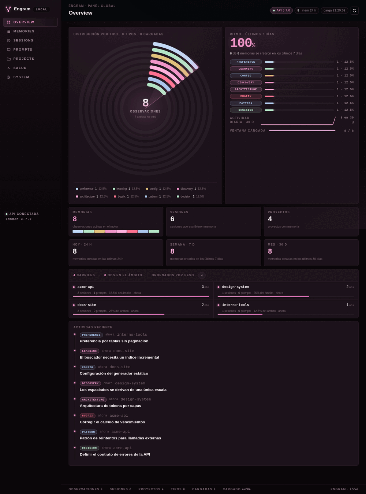

# engram-dashboard-local

Interfaz web local para consultar y gestionar la memoria de [Engram](https://github.com/Gentleman-Programming/engram). Backend con la librería estándar de Python y la API HTTP del motor; frontend en HTML, CSS y JavaScript sin compilación ni dependencias. Versión de referencia: **Engram 3.7.0**. Escucha en `http://127.0.0.1:7438` y no incorpora autenticación de usuarios.



## Qué incluye

- **Overview** global: totales, actividad de 24 h / 7 d / 30 d, serie diaria y distribución por tipo en un radar con leyenda interactiva.
- **Memories**: exploración por proyecto o global, búsqueda FTS del motor, filtros por tipo y sesión, orden configurable y aviso de carga parcial.
- **Sessions** con timeline de observaciones, **Prompts** y **Projects** con contadores y directorios asociados.
- **Salud** (relaciones y cola de revisión, solo lectura) y **System** (`doctor`, export JSON y comparación con la versión de referencia).
- **Detalle de una memoria**: Markdown acotado, edición de título, tipo, contenido, ámbito y clave temática, copia y descarga en Markdown o JSON.
- Atajos: `Ctrl`/`⌘`+`K` para buscar, `Esc` para cerrar detalle o modal.

El dashboard no crea observaciones, sesiones ni proyectos, y no juzga relaciones ni cambia estados de revisión: eso se hace con las herramientas de Engram.

## Borrado

Toda acción irreversible pasa por un modal común: genera un snapshot del export (`POST /api/snapshots`) antes de habilitar la confirmación, muestra su ruta y tamaño, exige tipear el id o el nombre exacto y envía esa ruta en `snapshot`.

| Acción en la interfaz | Ruta del backend |
| --- | --- |
| Drawer · «Ocultar (soft)» | `DELETE /api/observations/{id}?expected_project=P` |
| Drawer · «Borrar definitivamente (hard)» | `DELETE /api/observations/{id}?expected_project=P&hard=true&snapshot=RUTA` |
| Prompts · «Eliminar» | `DELETE /api/prompts/{id}?snapshot=RUTA` |
| Sessions · «Eliminar» (solo sesiones sin observaciones) | `DELETE /api/sessions/{id}?snapshot=RUTA` |
| Projects · «Eliminar proyecto» (soft o hard) | `DELETE /api/projects/{name}[?hard=true]&snapshot=RUTA` |
| Snapshot previo obligatorio | `POST /api/snapshots` |

El snapshot debe estar en `<data_dir>/dashboard-snapshots/` y tener menos de 10 minutos; el backend verifica ruta y frescura, no la interfaz. No hay papelera ni restore: el soft deja la fila oculta en el store, y el borrado físico, el de prompts, el de sesiones y la cascada son definitivos. **La cascada en modo soft ya borra los prompts para siempre** y deja las sesiones vacías; se ejecuta con el CLI del motor (`engram delete project`) porque no existe esa ruta por HTTP.

## Requisitos

- Python 3 (probado con 3.14; no se declara mínimo).
- Engram 3.7.0 instalado, con el binario en el `PATH`, en `~/.local/bin/engram` o en `ENGRAM_BIN`.
- Un navegador moderno. No hace falta `pip`, `npm`, entorno virtual ni compilar el frontend.

## Ejecución

```sh
./run.sh            # también: ./run.sh 7440   ·   o: python3 server.py
```

Si el puerto 7438 está ocupado, usa el siguiente libre (prueba hasta diez) y lo informa. Desde una terminal interactiva abre la URL en el navegador; `ENGRAM_DASH_NO_OPEN=1` lo desactiva.

Reutiliza la API si `/health` responde 200; si no, lanza `engram serve` y aborta si no arranca en unos segundos. `Ctrl+C` termina solo el motor que el dashboard haya lanzado.

## Configuración

| Variable | Predeterminado | Uso |
|---|---|---|
| `ENGRAM_DASH_HOST` | `127.0.0.1` | Dirección de escucha; mantenla en loopback. |
| `ENGRAM_DASH_PORT` | `7438` | Puerto del dashboard. |
| `ENGRAM_API` | `http://127.0.0.1:<ENGRAM_PORT>` | API del motor que se reutiliza. |
| `ENGRAM_PORT` | `7437` | Puerto para construir esa URL. |
| `ENGRAM_DATA_DIR` | `~/.engram` | Datos que hereda el motor **solo si el dashboard lo arranca**. |
| `ENGRAM_BIN` | `engram` en `PATH`, luego `~/.local/bin/engram` | Binario del motor. |
| `ENGRAM_HTTP_TOKEN` | vacío | Se añade como Bearer al reenviar al motor. |
| `ENGRAM_DASH_NO_OPEN` | vacío | Cualquier valor evita abrir el navegador. |
| `ENGRAM_DASH_DEBUG` | vacío | Registro HTTP; puede incluir consultas y nombres de proyectos. |

`ENGRAM_DATA_DIR` no cambia los datos de una API que ya está corriendo. Para aislar el dashboard, fijá también `ENGRAM_API` hacia otro motor y un `ENGRAM_DASH_PORT` distinto.

## Seguridad

Loopback, sin autenticación ni TLS: exponer otra interfaz, un proxy o un túnel da acceso a memorias y a escrituras. Ningún borrado del panel se puede deshacer, y el backend exige el snapshot aunque un cliente se saltee el modal. Un snapshot es memoria exportada en claro y no reemplaza un backup del store SQLite. Límites de confianza y reporte de problemas en [SECURITY.md](SECURITY.md).

## Limitaciones

- Memories carga 1000 observaciones y busca hasta 200 resultados del motor; filtros y orden se aplican sobre lo cargado.
- Overview es global aunque elijas un proyecto en otra vista, y se calcula con hasta 20000 observaciones activas.
- Sessions y Prompts muestran los 200 más recientes del ámbito.
- El detalle no ofrece versiones anteriores y su Markdown no interpreta HTML.
- `doctor` depende del proyecto seleccionado; puede reportar un proyecto desconocido.
- Un proyecto cuyo nombre empiece con guion puede hacer fallar la cascada: el CLI lo lee como opción y el dashboard responde `502` sin declarar éxito.

## Arranque automático y acceso de escritorio (opcional)

`deploy/engram-dashboard.service` es una unidad de usuario: ajustá `WorkingDirectory` y `ExecStart` a tu copia (por omisión `~/.local/share/engram-dashboard-local`) y activala con `systemctl --user enable --now engram-dashboard.service`. Con Omarchy: `omarchy webapp install Engram http://127.0.0.1:7438 "$PWD/icon.png"`.

## Créditos

Construido sobre [engram-dashboard-local](https://github.com/eSagraAI/engram-dashboard-local) de eSagra ([@eSagraAI](https://github.com/eSagraAI)): el dashboard original —backend con la librería estándar de Python, frontend sin dependencias, `run.sh`, tests, deploy y docs— viene de ahí. Gracias a eSagra por publicarlo.

Agregado en este fork: la superficie de borrado con snapshots de export obligatorios, la cascada de proyecto por CLI, la edición de `scope` y `topic_key`, el sondeo de health, el fallback de puerto, la apertura automática del navegador, la paleta rosa y los tests que cubren todo eso.

## Licencia

MIT, con atribución a `Engram Dashboard Local contributors`. Ver [LICENSE](LICENSE).
