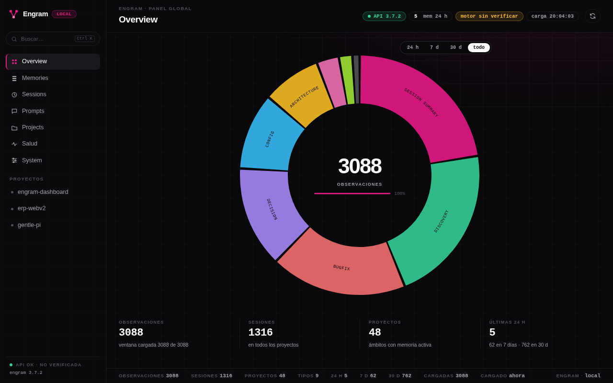
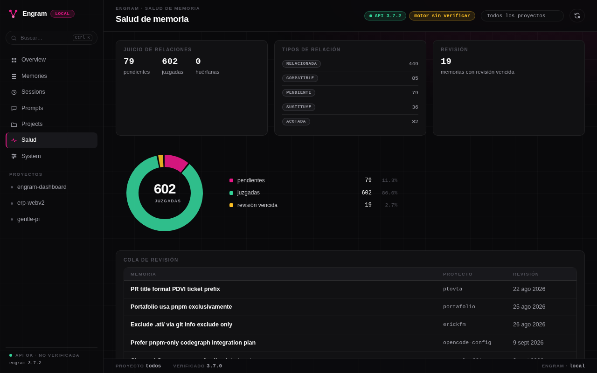
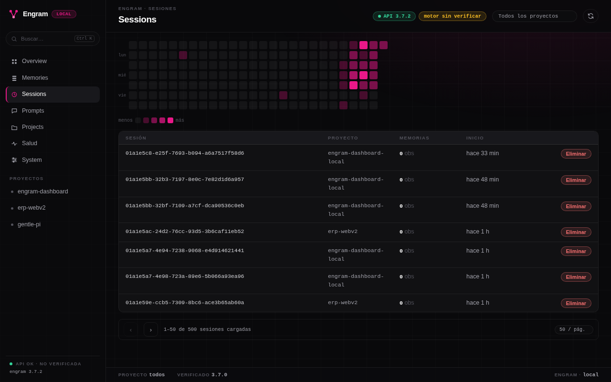

# engram-dashboard-local

Interfaz web local para consultar y gestionar la memoria de [Engram](https://github.com/Gentleman-Programming/engram). Backend con la librería estándar de Python y la API HTTP del motor; frontend en HTML, CSS y JavaScript sin compilación ni dependencias. Versión de referencia: **Engram 3.7.2**. Escucha en `http://127.0.0.1:7438` y no incorpora autenticación de usuarios.



## Qué incluye

- **Overview**: el radar de anillos con la distribución por tipo, y a su derecha el ritmo de los últimos 7 días, una barra por tipo con su conteo y porcentaje, la actividad diaria de 30 días y la ventana cargada. Debajo, seis cifras: memorias, sesiones, proyectos, hoy · 24 h, semana · 7 d y mes · 30 d. El radar **no repite la lista de tipos**: esa información ya está en la columna derecha, y **al tocar un anillo o su barra se abre Memories filtrado por ese tipo**.
- **Memories**: exploración por proyecto o global, búsqueda FTS del motor, filtros por tipo y sesión, orden configurable y aviso cuando el ámbito se truncó.
- **Sessions**: mapa de calor de 26 semanas por día, más el listado paginado con eliminación de sesiones vacías.
- **Prompts**: listado paginado con búsqueda y eliminación permanente.
- **Projects**: contadores por proyecto, directorios asociados y borrado suave o definitivo con cascada.
- **Salud**: dona de juicio de relaciones (pendientes, juzgadas, sin juicio) con su leyenda, tipos de relación, cola de revisión vencida y las tablas de relaciones y revisión, ambas paginadas. Solo lectura.
- **System**: `doctor`, export JSON y comparación con la versión de referencia.
- **Detalle de una memoria**: Markdown acotado, edición de título, tipo, contenido, ámbito y clave temática, copia y descarga en Markdown o JSON.





El dashboard no crea observaciones, sesiones ni proyectos, y no juzga relaciones ni cambia estados de revisión: eso se hace con las herramientas de Engram.

## Paginado

| Vista | Cómo pagina |
| --- | --- |
| Salud | **Servidor**: el dashboard reenvía `offset` a `/review` y `/conflicts`, así que recorre la cola completa |
| Sessions | **Cliente**: carga hasta 500 sesiones recientes y las trocea en el navegador |
| Prompts | **Cliente**: igual, hasta 500 prompts recientes |

El motor **ignora `offset`** en `/sessions/recent` y `/prompts/recent`: pedir `offset=3` devuelve los mismos primeros registros. Por eso esas dos vistas paginan sobre lo cargado y lo dicen en pantalla (`1–50 de 500 sesiones cargadas`), en lugar de simular un recorrido que no existe. Para paginar de verdad ahí hace falta soporte del motor.

## En vivo

El dashboard se actualiza solo mientras el store cambia, sin recargar la página ni parpadear.

Cada 4 segundos el navegador consulta `GET /api/beacon`, que devuelve una huella del store: un `sha1` corto sobre `mtime` y tamaño de `engram.db` **y** `engram.db-wal`. Los dos archivos importan, porque con WAL activo hay escrituras que mueven el `-wal` sin tocar el principal. El endpoint cuesta un `stat`, no una consulta al motor: el estado de salud se cachea 10 segundos.

Si la huella cambió, recién ahí se pide `/api/overview` —el endpoint caro, hasta 20 000 observaciones— y la vista se **parchea nodo por nodo**: el número del centro, el `stroke-dasharray` de cada anillo, el ancho de cada barra, el total de cada tile. Nada de `location.reload()` ni de reemplazar el bloque entero: los nodos que no cambiaron siguen siendo los mismos objetos del DOM, así que no hay repintado ni salto.

Cuando el parcheo no corresponde —estás en otra vista, hay un drawer o un diálogo abierto, o el foco está en un campo— el cambio no se aplica y aparece un pill `N nuevas` en la barra superior para aplicarlo cuando quieras.

Detalles de comportamiento: con la pestaña oculta no se consulta nada; un botón de recarga o volver a la pestaña rearranca el ciclo; después de tres fallas consecutivas de `/api/beacon` el ciclo se detiene (ver Limitaciones).

Esto es **polling**, no push: el motor no expone eventos (`/events`, `/stream`, `/watch` responden 404), así que no hay forma de que avise. La latencia máxima es la del intervalo, 4 segundos.

## Borrado

Toda acción irreversible pasa por un modal común: genera un snapshot del export (`POST /api/snapshots`) antes de habilitar la confirmación, muestra su ruta y tamaño, exige tipear el id o el nombre exacto y envía esa ruta en `snapshot`.

| Acción en la interfaz | Ruta del backend |
| --- | --- |
| Drawer · «Ocultar (soft)» | `DELETE /api/observations/{id}?expected_project=P` |
| Drawer · «Borrar definitivamente (hard)» | `DELETE /api/observations/{id}?expected_project=P&hard=true&snapshot=RUTA` |
| Prompts · «Eliminar» | `DELETE /api/prompts/{id}?snapshot=RUTA` |
| Sessions · «Eliminar» (solo sesiones sin observaciones) | `DELETE /api/sessions/{id}?snapshot=RUTA` |
| Projects · «Eliminar proyecto» (soft o hard) | `DELETE /api/projects/{name}[?hard=true]&snapshot=RUTA` |
| Snapshot previo obligatorio | `POST /api/snapshots` |

El snapshot debe estar en `<data_dir>/dashboard-snapshots/` y tener menos de 10 minutos; el backend verifica ruta y frescura, no la interfaz. No hay papelera ni restore: el soft deja la fila oculta en el store, y el borrado físico, el de prompts, el de sesiones y la cascada son definitivos. **La cascada en modo soft ya borra los prompts para siempre** y deja las sesiones vacías; se ejecuta con el CLI del motor (`engram delete project`) porque no existe esa ruta por HTTP.

## Requisitos

- Python 3 (probado con 3.14; no se declara mínimo).
- Engram 3.7.2 instalado, con el binario en el `PATH`, en `~/.local/bin/engram` o en `ENGRAM_BIN`.
- Un navegador moderno. No hace falta `pip`, `npm`, entorno virtual ni compilar el frontend.

## Ejecución

```sh
./run.sh            # también: ./run.sh 7440   ·   o: python3 server.py
```

Si el puerto 7438 está ocupado, usa el siguiente libre (prueba hasta diez) y lo informa. Desde una terminal interactiva abre la URL en el navegador; `ENGRAM_DASH_NO_OPEN=1` lo desactiva.

Reutiliza la API si `/health` responde 200; si no, lanza `engram serve` y aborta si no arranca en unos segundos. `Ctrl+C` termina solo el motor que el dashboard haya lanzado.

## Configuración

| Variable | Predeterminado | Uso |
|---|---|---|
| `ENGRAM_DASH_HOST` | `127.0.0.1` | Dirección de escucha; mantenla en loopback. |
| `ENGRAM_DASH_PORT` | `7438` | Puerto del dashboard. |
| `ENGRAM_API` | `http://127.0.0.1:<ENGRAM_PORT>` | API del motor que se reutiliza. |
| `ENGRAM_PORT` | `7437` | Puerto para construir esa URL. |
| `ENGRAM_DATA_DIR` | `~/.engram` | Datos que hereda el motor **solo si el dashboard lo arranca**. |
| `ENGRAM_BIN` | `engram` en `PATH`, luego `~/.local/bin/engram` | Binario del motor. |
| `ENGRAM_HTTP_TOKEN` | vacío | Se añade como Bearer al reenviar al motor. |
| `ENGRAM_DASH_NO_OPEN` | vacío | Cualquier valor evita abrir el navegador. |
| `ENGRAM_DASH_DEBUG` | vacío | Registro HTTP; puede incluir consultas y nombres de proyectos. |

`ENGRAM_DATA_DIR` no cambia los datos de una API que ya está corriendo. Para aislar el dashboard, fijá también `ENGRAM_API` hacia otro motor y un `ENGRAM_DASH_PORT` distinto.

## Interfaz

Un solo lenguaje visual para todas las vistas: fondo casi negro (`#09090b`), superficies en `#111113` y `#18181c`, un acento magenta (`#ea1889`) y el resto del color reservado a los datos. Las etiquetas de sección son micro-tipografía en mayúsculas, los números van en monoespaciada y las tarjetas se reemplazan por líneas de 1 px donde no hacen falta cajas. Los tipos de observación tienen un tono fijo que se repite en la dona, en los badges y en las tablas.

No hay fuentes externas, imágenes remotas ni CDN: todo es stack de sistema y SVG generado en el cliente.

## Seguridad

Loopback, sin autenticación ni TLS: exponer otra interfaz, un proxy o un túnel da acceso a memorias y a escrituras. Ningún borrado del panel se puede deshacer, y el backend exige el snapshot aunque un cliente se saltee el modal. Un snapshot es memoria exportada en claro y no reemplaza un backup del store SQLite. Límites de confianza y reporte de problemas en [SECURITY.md](SECURITY.md).

## Limitaciones

- Memories carga 1000 observaciones y busca hasta 200 resultados del motor; filtros y orden se aplican sobre lo cargado.
- Overview es global aunque elijas un proyecto en otra vista, y se calcula con hasta 20000 observaciones activas. Sus ventanas (24 h / 7 d / 30 d / todo) son visuales: el motor no entrega el reparto por tipo y por ventana en la misma respuesta.
- Sessions y Prompts paginan en el cliente porque el motor ignora `offset` en esas rutas; el total aparece solo cuando el dashboard ya conoce los contadores por proyecto.
- El detalle no ofrece versiones anteriores y su Markdown no interpreta HTML.
- `doctor` depende del proyecto seleccionado; puede reportar un proyecto desconocido.
- Un proyecto cuyo nombre empiece con guion puede hacer fallar la cascada: el CLI lo lee como opción y el dashboard responde `502` sin declarar éxito.
- La suite espera el binario del motor: los tests de integración arrancan `engram serve`, así que sin binario fallan antes de probar nada.
- En vivo: si `/api/beacon` falla tres veces seguidas (un reinicio del dashboard, un corte momentáneo), el ciclo se detiene y solo rearranca al recargar o al volver a la pestaña. Además, como la huella incluye el `-wal`, un checkpoint de SQLite que no cambia ningún dato también la mueve, y eso provoca un refresco de más.

## Arranque automático y acceso de escritorio (opcional)

`deploy/engram-dashboard.service` es una unidad de usuario: ajustá `WorkingDirectory` y `ExecStart` a tu copia (por omisión `~/.local/share/engram-dashboard-local`) y activala con `systemctl --user enable --now engram-dashboard.service`. Con Omarchy: `omarchy webapp install Engram http://127.0.0.1:7438 "$PWD/icon.png"`.

## Créditos

Construido sobre [engram-dashboard-local](https://github.com/eSagraAI/engram-dashboard-local) de eSagra ([@eSagraAI](https://github.com/eSagraAI)): el dashboard original —backend con la librería estándar de Python, frontend sin dependencias, `run.sh`, tests, deploy y docs— viene de ahí. Gracias a eSagra por publicarlo.

Agregado en este fork: la superficie de borrado con snapshots de export obligatorios, la cascada de proyecto por CLI, la edición de `scope` y `topic_key`, el sondeo de health, el fallback de puerto, la apertura automática del navegador, el rediseño completo de la interfaz (dona navegable, mapa de calor, paginado por vista y el sistema visual documentado en `design/`), y los tests que cubren todo eso.

## Licencia

MIT, con atribución a `Engram Dashboard Local contributors`. Ver [LICENSE](LICENSE).
